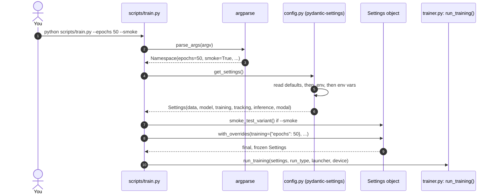
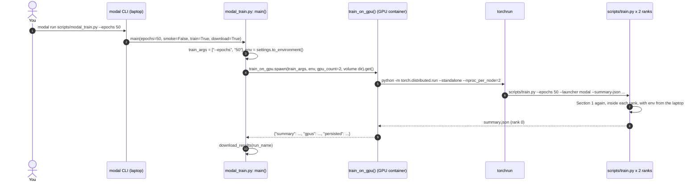
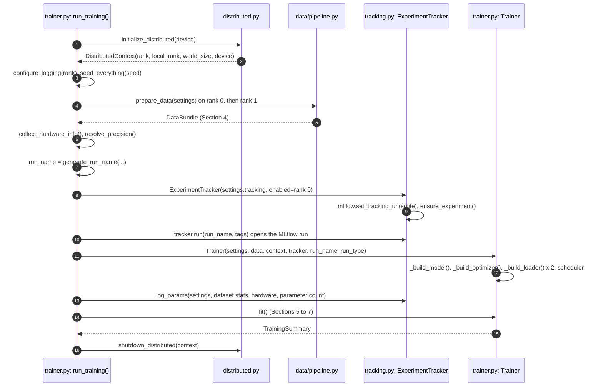
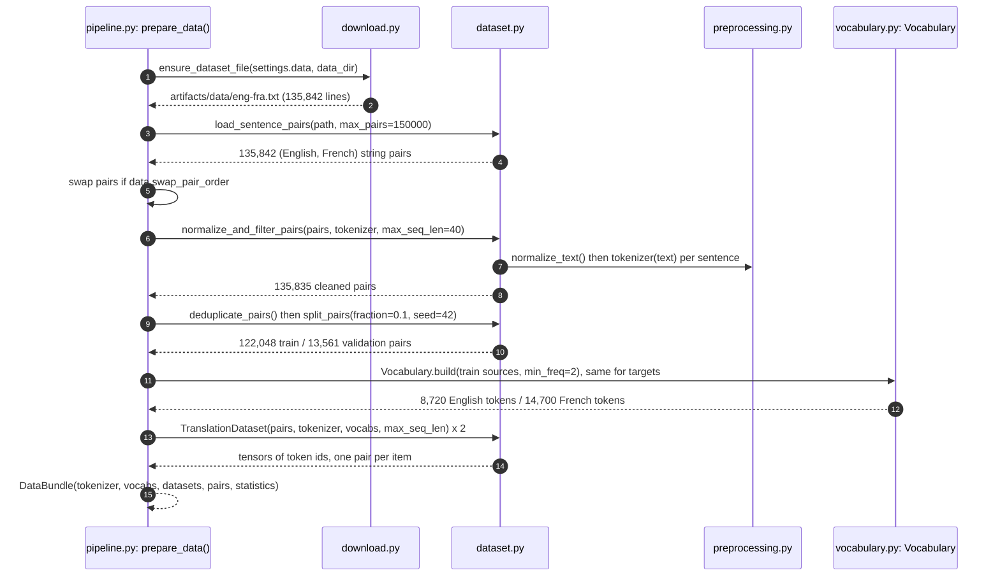
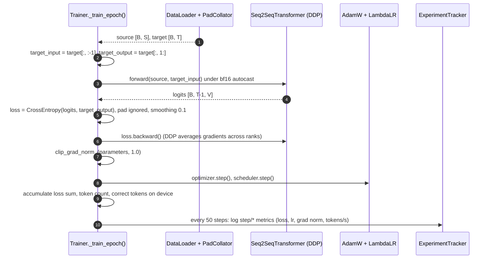
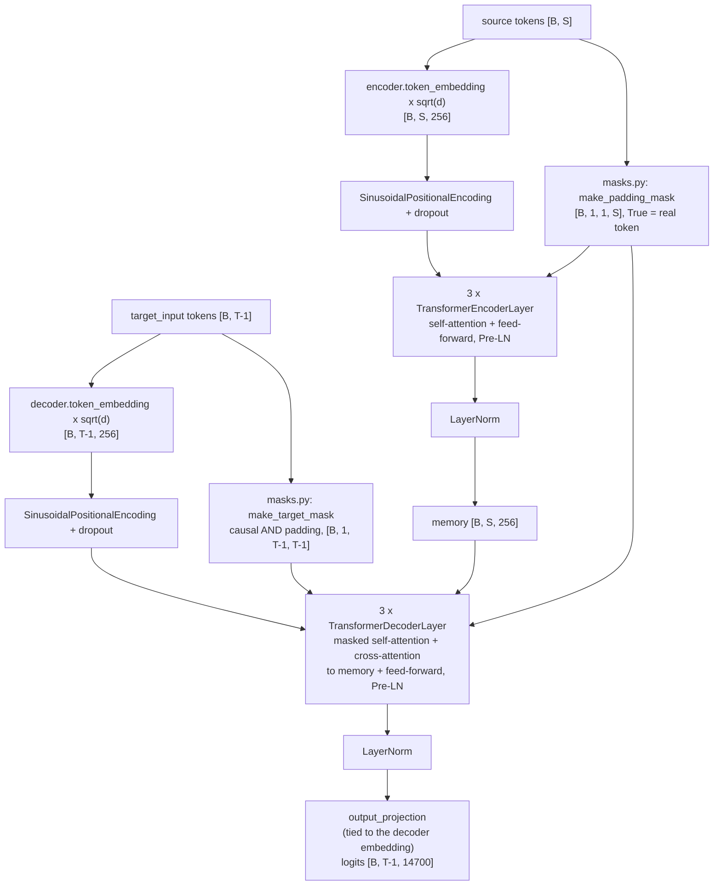
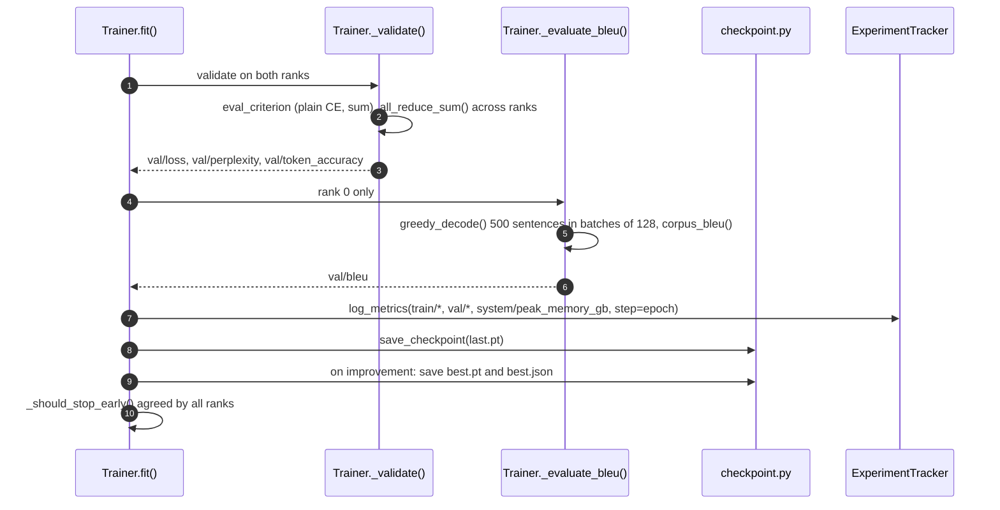
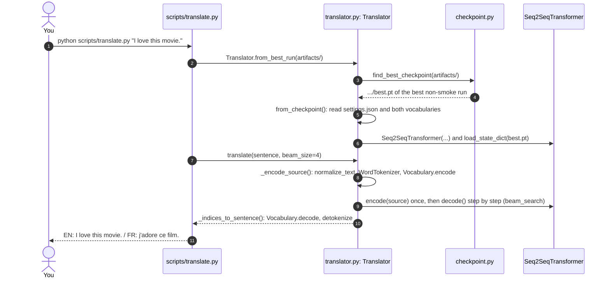

# Runtime logic, step by step

[workflow.md](workflow.md) explains *where* things happen (laptop, Modal, Volume) and how the pieces
connect. This document explains *how the code itself runs*: how the command you type is turned into
Python objects, how the program knows which model and which languages it is training, how the data
moves through the pipeline and in what sizes, what every training step does, and which function,
class or method of which file is executing at each moment. Names in `monospace` are real identifiers
from the source code.

Numbers below use the default configuration (English → French, two GPUs, batch 128 per GPU). Other
runs differ only in the counts, never in the logic.

## 1. From the command line to a `Settings` object

Everything starts with a terminal command. Two commands exist: the local one, which runs training in
the current machine, and the Modal one, which runs the local one inside a GPU container.

```bash
uv run python scripts/train.py --epochs 50 --smoke             # local
uv run --env-file .env modal run scripts/modal_train.py --epochs 50   # Modal (see Section 2)
```



1. The shell starts Python with `scripts/train.py` and the flags you typed.
2. `main()` in `scripts/train.py` calls `parse_args()`, a standard `argparse` parser that knows the
   flags `--epochs`, `--batch-size`, `--precision`, `--max-pairs`, `--run-name`, `--experiment`,
   `--device`, `--launcher`, `--smoke` and `--summary-json`.
3. The parser returns a `Namespace`: a small object with one attribute per flag (`None` when a flag
   was not given, except `launcher`, which defaults to `"local"`, and `smoke`, which defaults to
   `False`).
4. `build_settings()` calls `get_settings()` from `config.py`.
5. Pydantic builds each settings section (`DataSettings`, `ModelSettings`, `TrainingSettings`,
   `TrackingSettings`, `InferenceSettings`, `ModalSettings`) from three layers, later layers winning:
   the defaults written in the class, the `.env` file in the working directory, and environment
   variables such as `TRAINING_EPOCHS=50` (section prefix + field name in upper case).
6. The result is one `Settings` object that groups the six sections.
7. If `--smoke` was given, `Settings.smoke_test_variant()` returns a copy with 3,000 pairs, 2 epochs,
   batch 32, a 20-step warm-up and the experiment name suffixed with `-smoke`.
8. `Settings.with_overrides()` applies the command-line flags on top (`--epochs` → `training.epochs`,
   `--max-pairs` → `data.max_pairs`, `--run-name` and `--experiment` → `tracking`). Unknown field names
   raise an error instead of being ignored.
9. The settings object is frozen: nothing changes it afterwards, so every part of the program sees the
   same configuration.
10. `run_training()` in `training/trainer.py` receives it and does all the work (Section 3).

### How does the program know which model it is training?

There is no "model name" argument. The identity of a run is the combination of settings below, and
the run name is generated from them.

| Question | Setting (env var) | Used by |
|---|---|---|
| Which corpus file? | `data.source_url`, `data.archive_member` (`DATA_SOURCE_URL`, `DATA_ARCHIVE_MEMBER`) | `data/download.py: ensure_dataset_file()` |
| Which direction? | `data.source_language`, `data.target_language`, `data.swap_pair_order` | `data/pipeline.py: prepare_data()`, run name, API language codes |
| How big is the network? | `model.d_model`, `model.num_heads`, `model.num_encoder_layers`, `model.num_decoder_layers`, `model.dim_feedforward` | `model/transformer.py: Seq2SeqTransformer.__init__()` |
| How long and how fast? | `training.epochs`, `training.batch_size`, `training.warmup_steps`, `training.precision` | `training/trainer.py: Trainer` |
| Where do results go? | `tracking.artifacts_dir`, `tracking.experiment_name`, `tracking.run_name` | `training/tracking.py`, `training/checkpoint.py` |

The run name is built by `generate_run_name()` in `trainer.py` as
`<date-time>-<pair>-<gpu>-<precision>-bs<global batch>-<run type>`, for example
`20261030-2020-eng-fra-a100-sxm4-40gb-bf16-bs256-full`, where `<pair>` comes from
`language_pair_slug(source_language, target_language)`.

## 2. The Modal command path

`scripts/modal_train.py` is a Modal app. The `modal run` command imports it, turns the typed arguments
of its `main()` function into command-line options, and calls `main()` on your laptop.



1. You run `modal run` with the flags.
2. Modal reads the type hints of `main(epochs: int | None, batch_size: int | None, precision: str |
   None, run_name: str | None, smoke: bool, train: bool, download: bool, all_checkpoints: bool)` and
   fills them from the command line.
3. `main()` rebuilds the flags as a list of strings for `scripts/train.py` and calls
   `Settings.to_environment()`, which renders the `data`, `model`, `training` and `tracking` sections as
   `PREFIX_FIELD=value` pairs (for example `DATA_TARGET_LANGUAGE=Spanish`).
4. `train_on_gpu.spawn(...)` sends both to the GPU container; `.get()` waits for the result.
5. Inside the container, `train_on_gpu()` runs `torchrun` as a subprocess with one process per GPU
   (`--nproc_per_node=2`) and the exported variables in its environment.
6. `torchrun` starts two copies of `scripts/train.py` and sets `RANK`, `LOCAL_RANK` and `WORLD_SIZE`
   for each.
7. Each copy goes through Section 1 unchanged; because the environment carries the laptop's exported
   settings, both ranks build the same `Settings` the laptop would have built, with three
   differences: `train_on_gpu()` sets `TRACKING_ARTIFACTS_DIR=/root/artifacts` (so every derived path,
   including the MLflow database, points inside the container), it removes any
   `TRACKING_MLFLOW_TRACKING_URI` (the container always uses the restored SQLite store), and `main()`
   never sends `DATA_LOCAL_FILE` (the container downloads the corpus). This is why `download_results()`
   has to relocate the MLflow store afterwards.
8. Rank 0 writes `summary.json` when training ends.
9. `train_on_gpu()` returns it with the GPU names and the list of persisted paths.
10. `main()` downloads the results into `artifacts/modal/` (details in workflow.md, Flow A).

## 3. `run_training()`: preparing everything before the first batch



1. `initialize_distributed()` in `training/distributed.py` reads `WORLD_SIZE`, `RANK` and
   `LOCAL_RANK`. With `WORLD_SIZE` > 1 it joins an NCCL process group and pins the process to GPU
   `local_rank`; otherwise it picks the best local device (`cuda`, `mps` or `cpu`).
2. It returns a `DistributedContext` with `is_main_process` (rank 0) and `is_distributed` properties
   that the rest of the code consults.
3. Logging is configured with the rank in every line (`utils/logging.py: configure_logging()`) and
   all random number generators are seeded (`utils/seed.py: seed_everything()`).
4. Rank 0 calls `prepare_data()` first so only one process downloads the corpus; a barrier makes rank
   1 wait, then it calls `prepare_data()` on the cached file.
5. The result is a `DataBundle` holding the tokenizer, both vocabularies, both datasets, the raw
   validation pairs (needed for BLEU) and statistics.
6. `collect_hardware_info()` (`utils/hardware.py`) records GPU name, memory, CUDA and PyTorch
   versions; `resolve_precision()` (`training/precision.py`) decides bf16 on Ampere-class GPUs, fp16
   with a `GradScaler` on older ones, fp32 elsewhere.
7. The run name is generated unless `TRACKING_RUN_NAME` / `--run-name` fixed it.
8. The `ExperimentTracker` is created enabled only on rank 0; on rank 1 every tracking call is a
   no-op.
9. On creation it points MLflow at `sqlite:///<artifacts>/mlflow.db`, creates the experiment with its
   artifact folder if needed and turns on system metrics (CPU, RAM, GPU).
10. `tracker.run()` opens the MLflow run with tags (project, language pair, run type, launcher, GPU,
    precision, world size, git commit).
11. The `Trainer` is constructed.
12. Its constructor builds the model (`_build_model()`: `Seq2SeqTransformer` moved to the device,
    optionally compiled, wrapped in `DistributedDataParallel` when there are two ranks), the optimizer
    (`_build_optimizer()`: `AdamW`, β = (0.9, 0.98), ε = 1e-9, no weight decay on biases, norms and
    embeddings), the two data loaders (`_build_loader()` for train and validation), the learning-rate
    schedule (`scheduler.py: create_lr_scheduler()`, Noam by default), the loss functions and the
    optional `GradScaler`.
13. Everything that describes the run is logged once as MLflow parameters.
14. `fit()` runs the epochs.
15. It returns a `TrainingSummary`.
16. The process group is torn down.

## 4. The data pipeline and the size of what flows through it

`prepare_data()` in `data/pipeline.py` turns a text file into tensors. Every stage, with its function
and the size of its output for the English → French corpus:



1. `ensure_dataset_file()` returns the cached text file, downloading the zip (`download_file()`) and
   extracting one member (`extract_archive_member()`) the first time. Both writes are atomic (a
   temporary file is renamed into place) so an interrupted download never leaves a half file.
2. The file has one pair per line: `English<TAB>French`.
3. `load_sentence_pairs()` reads at most `data.max_pairs` lines (150,000 by default, more than the file
   has) and keeps the first two columns.
4. The result is a plain Python list of string tuples.
5. If `data.swap_pair_order` is true (Spanish → English), the two columns are swapped here, so the rest
   of the pipeline always sees `(source, target)`.
6. `normalize_and_filter_pairs()` cleans both sides and drops pairs that are too long.
7. `normalize_text()` lower-cases, keeps letters with accents and the `œ` ligature, maps typographic
   apostrophes to `'`, separates `. ! ?` from words and removes everything else. `WordTokenizer()`
   then splits on words and those three punctuation marks. A pair is kept only if the source has 1 to
   40 tokens and the target 1 to 38 (room for the start and end markers).
8. Almost nothing is dropped for this corpus (7 pairs).
9. `deduplicate_pairs()` removes exact duplicates (226 here); `split_pairs()` groups pairs by source
   sentence, shuffles the groups with seed 42 and moves whole groups to validation until 10% of the
   pairs is reached, so an English sentence never appears on both sides.
10. The split is roughly 90/10.
11. `Vocabulary.build()` counts tokens in the **training** half only and keeps those seen at least
    twice (`data.min_token_freq`), ordered by frequency. Four special tokens come first in every
    vocabulary: `<pad>` = 0, `<unk>` = 1, `<sos>` = 2, `<eos>` = 3.
12. Rare words in validation therefore become `<unk>` exactly as they would for a user's sentence.
13. `TranslationDataset.__init__()` encodes every pair once: the source becomes its token ids, the
    target becomes `[2, ids..., 3]` (`<sos>` ... `<eos>`), both truncated to 40.
14. Each item of the dataset is a pair of 1-D integer tensors of different lengths.
15. The `DataBundle` is handed back to `run_training()`.

### From items to batches

The `Trainer` wraps each dataset in a PyTorch `DataLoader` through `dataset.py: build_dataloader()`:

| Setting | Value | Effect |
|---|---|---|
| `training.batch_size` | 128 | sentences per GPU per step |
| GPUs (`world_size`) | 2 | `DistributedSampler` gives each rank a disjoint half of the data, so a step covers 256 sentences |
| `data.pad_to_multiple_of` | 8 | `PadCollator` pads every batch to a length that is a multiple of 8 (efficient on tensor cores) |
| `data.num_workers` | 0 | tensors are precomputed, so no worker processes are needed |

`PadCollator.__call__()` receives 128 `(source, target)` items and returns two 2-D tensors: `source`
of shape `[128, S]` and `target` of shape `[128, T]`, where `S` and `T` are the longest source and
target in that batch rounded up to a multiple of 8 (typically 16 to 24 for this corpus, at most 40).
Short sentences are padded with `0`. With 122,048 training pairs and 256 per step, an epoch is
477 steps per rank.

## 5. One training step

`Trainer._train_epoch()` in `training/trainer.py` loops over the training loader. This is what one
iteration does, with tensor shapes (`B` = 128 sentences, `S` source length, `T` target length,
`V` = 14,700 French tokens, `d` = 256 model width):



1. The loader yields one padded batch; both tensors are moved to the GPU with `non_blocking=True`.
2. Teacher forcing: the decoder reads the target shifted right (`<sos> w1 w2 ...`) and must predict
   the same sequence shifted left (`w1 w2 ... <eos>`). `_split_target()` builds both views.
3. `forward()` runs under `autocast_context()` (`training/precision.py`): matrix multiplications use
   bf16 on an A100, everything numerically sensitive stays in fp32. Section 6 opens the model.
4. The output is one score per vocabulary word for every target position.
5. `train_criterion` is `nn.CrossEntropyLoss(ignore_index=0, label_smoothing=0.1)`: padding positions
   do not count, and 10% of the probability mass is spread over all words so the model does not become
   over-confident.
6. `backward()` computes gradients. Because the model is wrapped in `DistributedDataParallel`, the
   two ranks exchange and average their gradients automatically during this call, so both end up with
   identical updates.
7. `torch.nn.utils.clip_grad_norm_()` caps the total gradient size at `training.grad_clip_norm`
   (1.0) and returns the pre-clip norm, which is tracked as a health metric. With fp16 the
   `GradScaler` scales the loss before `backward()` and un-scales here.
8. `AdamW` applies the update; the `LambdaLR` scheduler then moves the learning rate along the Noam
   curve (`scheduler.py: noam_learning_rate()`: linear warm-up for 2,000 steps, then decay with the
   inverse square root of the step).
9. Loss × tokens, token count and correct predictions are accumulated in on-device tensors
   (`_batch_statistics()`), so no step waits for the GPU except when logging.
10. Every `training.log_every_n_steps` (50) steps, rank 0 reads the current values and logs them to
    MLflow under `step/*` (`ExperimentTracker.log_metrics(..., step=global_step)`).

## 6. Inside the model

`Seq2SeqTransformer.forward()` in `model/transformer.py` is two calls: `encode()` then `decode()`.



- `TransformerEncoder.forward()` (`model/encoder.py`) embeds the tokens, scales by √256 as in the
  paper, adds sinusoidal positions (`model/layers.py: SinusoidalPositionalEncoding`) and runs the
  layer stack. Padding positions are hidden from attention by the padding mask.
- Each `TransformerEncoderLayer` (`model/layers.py`) applies `MultiHeadAttention`
  (`model/attention.py`, 8 heads of 32 dimensions, computed with
  `torch.nn.functional.scaled_dot_product_attention`) and a `PositionwiseFeedForward` block
  (256 → 512 → 256) with residual connections and LayerNorm before each sub-layer (Pre-LN).
- `TransformerDecoder.forward()` (`model/decoder.py`) does the same for the target, with two
  differences: its self-attention uses `make_target_mask()` so position *t* can only look at positions
  ≤ *t* (no peeking at the answer), and each layer has a second attention that reads the encoder's
  `memory`, restricted by the source padding mask.
- The final `output_projection` shares its weight matrix with the decoder embedding
  (`model.tie_target_embeddings`), which is why the model has 9.95M parameters instead of 13.7M.

## 7. End of an epoch: validation, BLEU, checkpoints



1. `_validate()` runs the model in eval mode on the validation loader of each rank.
2. It uses a second loss without label smoothing (`eval_criterion`, summed over tokens) so the
   reported number is the true negative log-likelihood; `distributed.py: all_reduce_sum()` adds the
   sums and counts of both ranks before dividing, so the result is exact.
3. `metrics.py: TokenLossAccumulator` converts the sums into mean loss, perplexity (`exp(loss)`) and
   token accuracy.
4. Only rank 0 computes BLEU; rank 1 waits at a barrier.
5. `_decode_validation_subset()` takes the first 500 validation pairs, calls
   `Seq2SeqTransformer.greedy_decode()` on batches of 128 (always picking the most likely next word,
   at most 40 words) and `metrics.py: corpus_bleu()` scores the output with sacreBLEU against the
   reference French.
6. BLEU joins the epoch metrics.
7. Epoch metrics are logged with the epoch number as the step.
8. `_save_checkpoints()` always rewrites `last.pt` through `checkpoint.py: save_checkpoint()` (model,
   optimizer, scheduler and scaler state, epoch, step), and every 5 epochs also `epoch-XXX.pt`.
9. `_is_improvement()` compares `val/loss` with the best so far; on improvement `best.pt` is written
   and `BestCheckpointSummary` records metric, value, epoch, file name and run type in `best.json`.
10. If `training.early_stopping_patience` is set and no improvement happened for that many epochs,
    rank 0 raises a flag that `all_reduce_sum()` spreads to every rank so both stop together (off by
    default: all 50 epochs run).

At the end of the last epoch `Trainer._finalize()` saves `history.json`/`history.csv`
(`metrics.py: TrainingHistory`), renders `training_curves.png` and `step_dynamics.png`
(`plotting.py`), decodes a dozen sample translations, uploads checkpoint, metadata, history and plots
to MLflow (`ExperimentTracker.log_artifact()`, `log_dict()`, `log_figure()`) and returns the
`TrainingSummary`.

## 8. Inference logic: the same model, read back

### Command line



1. You pass one or more sentences (none opens an interactive prompt).
2. Without `--checkpoint` (or `INFERENCE_CHECKPOINT_PATH`), `load_translator()` calls
   `Translator.from_best_run(artifacts/)`; with either of them it calls `Translator.from_checkpoint()`
   on that file directly.
3. `from_best_run()` calls `checkpoint.py: find_best_checkpoint()`, which scans `artifacts/`
   recursively for `best.json` cards with weights beside them, drops smoke runs when full runs exist,
   requires the remaining runs to share one selection metric (otherwise it stops with an error; only
   the API's `ModelRegistry.models()` catches that and groups by metric instead) and returns the best.
4. The chosen `best.pt` is handed back.
5. `from_best_run()` passes it to `Translator.from_checkpoint()`, which reads the run directory:
   `settings.json` gives the architecture (`ModelSettings`) and the training-time sentence limit; the
   two vocabulary files restore the exact word ↔ id mapping used in training.
6. The model is rebuilt with those settings and the saved weights are loaded (`torch.load(...,
   weights_only=True)`), on the best available device.
7. `translate()` with `beam_size` 4 (the default from `InferenceSettings`).
8. The sentence is cleaned and tokenised with the same functions as training; unknown words become
   `<unk>`; the result is a `[1, S]` tensor.
9. The encoder runs once; `beam_search()` then calls `decode()` one word at a time keeping up to 4
   alive partial sentences and the 4 best finished ones. It stops when no partial sentence is left
   alive, when 4 finished sentences exist and even the worst of them scores at least as well (after
   the 0.6 length penalty) as the best alive beam, or when `max_decode_len` (40) words have been
   generated, in which case the alive beams compete with the finished ones. `beam_size` 1 instead
   calls `greedy_decode()`.
10. Ids are mapped back to words (`Vocabulary.decode()` stops at `<eos>` and drops specials) and
    punctuation is re-attached (`WordTokenizer.detokenize()`).
11. The translation is printed.

### FastAPI service

`fastapi dev` imports `transformer_nmt.api.app:app`, created by `create_app()`. Its `lifespan` hook
builds a `ModelRegistry` (`api/registry.py`) that calls `discover_checkpoints()` and
`rank_checkpoints()` from `checkpoint.py`, reads each run's languages from its `settings.json`
(`ModelRegistry._languages_of()`) and loads the best run of every direction with
`Translator.from_checkpoint()`. A `POST /translate` with `{"text", "source_language",
"target_language", "beam_size"}` calls `ModelRegistry.translator_for(source, target)` and then exactly
the `translate()` path above; `POST /translate/stream` calls `Translator.stream_greedy()`, which yields
one word per decoder step so the server can send it immediately as a server-sent event. workflow.md
Section 7 lists every endpoint.

## 9. Quick index: which code runs when

| Moment | File | Function / class |
|---|---|---|
| Parse the command | `scripts/train.py` | `parse_args()`, `build_settings()`, `main()` |
| Build the configuration | `src/transformer_nmt/config.py` | `get_settings()`, `Settings.with_overrides()`, `Settings.smoke_test_variant()` |
| Send to Modal | `scripts/modal_train.py` | `main()`, `train_on_gpu()`, `download_results()` |
| Set up ranks and devices | `training/distributed.py` | `initialize_distributed()`, `all_reduce_sum()`, `barrier()` |
| Download and cache the corpus | `data/download.py` | `ensure_dataset_file()`, `download_file()`, `extract_archive_member()` |
| Clean, split, encode | `data/dataset.py`, `data/preprocessing.py`, `data/vocabulary.py` | `load_sentence_pairs()`, `normalize_and_filter_pairs()`, `deduplicate_pairs()`, `split_pairs()`, `normalize_text()`, `WordTokenizer`, `Vocabulary.build()`, `TranslationDataset` |
| Batch | `data/dataset.py` | `PadCollator`, `build_dataloader()` |
| Build the network | `model/transformer.py`, `encoder.py`, `decoder.py`, `layers.py`, `attention.py`, `masks.py` | `Seq2SeqTransformer`, `TransformerEncoder`, `TransformerDecoder`, `TransformerEncoderLayer`, `TransformerDecoderLayer`, `MultiHeadAttention`, `make_padding_mask()`, `make_target_mask()` |
| Precision and schedule | `training/precision.py`, `training/scheduler.py` | `resolve_precision()`, `autocast_context()`, `create_grad_scaler()`, `create_lr_scheduler()`, `noam_learning_rate()` |
| Train, validate, score | `training/trainer.py`, `training/metrics.py` | `Trainer.fit()`, `_train_epoch()`, `_validate()`, `_evaluate_bleu()`, `TokenLossAccumulator`, `corpus_bleu()` |
| Save and pick checkpoints | `training/checkpoint.py` | `save_checkpoint()`, `BestCheckpointSummary`, `discover_checkpoints()`, `rank_checkpoints()`, `find_best_checkpoint()` |
| Track the experiment | `training/tracking.py`, `training/plotting.py` | `ExperimentTracker`, `relocate_mlflow_store()`, `plot_training_curves()`, `plot_step_dynamics()` |
| Translate | `inference/translator.py`, `api/app.py`, `api/registry.py` | `Translator.from_best_run()`, `Translator.from_checkpoint()`, `translate()`, `beam_search()`, `stream_greedy()`, `create_app()`, `ModelRegistry.translator_for()` |
