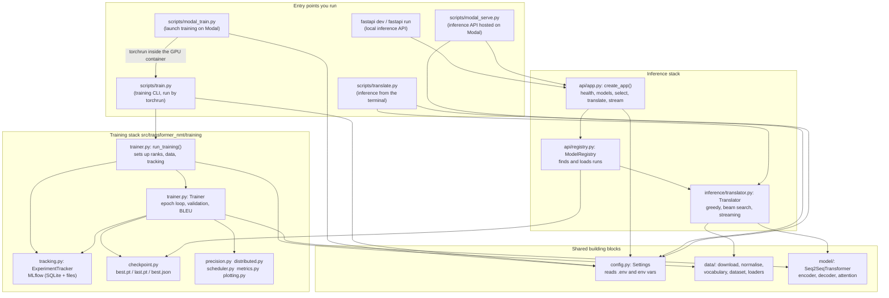
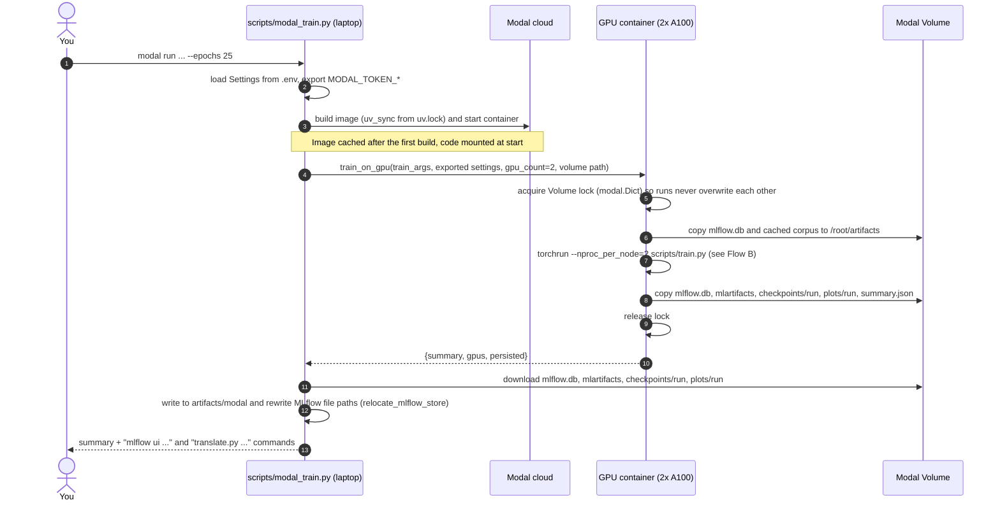
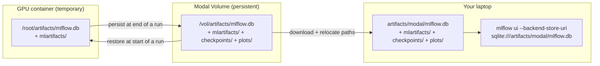
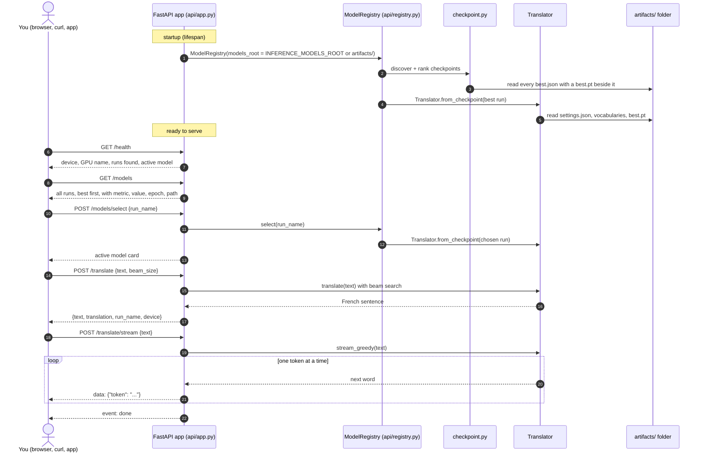
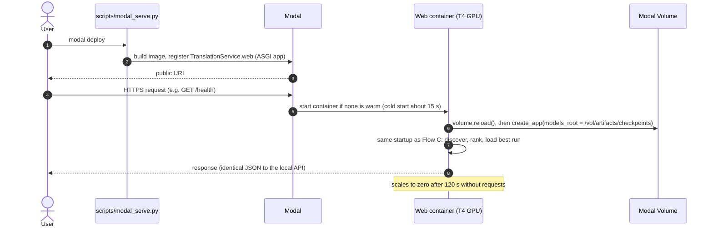
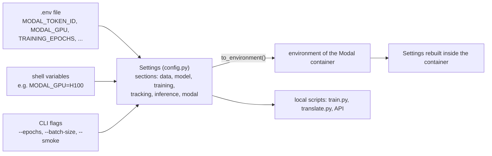
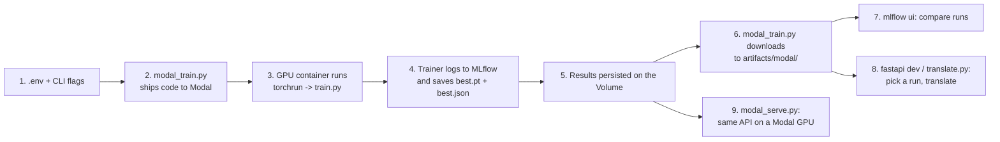

# How the project fits together

This guide explains, step by step, how the pieces of this repository talk to each other: where a
training run starts, which file sends work to Modal (the cloud GPU provider), what happens inside the
GPU machine, where MLflow (the experiment notebook) records things, how results come back to your
laptop, and how the translation API finds and loads the best model. It is written for readers who do
not program; the diagrams are in Mermaid and render on GitHub.

If you only remember one thing: **everything starts from a settings file and ends in the
`artifacts/` folder**. Training fills that folder with checkpoints, metrics and plots; inference reads
it back.

## 1. The cast of characters

| Component | Plain-English role | Where it lives |
|---|---|---|
| Settings | The single rulebook. Every knob (model size, epochs, GPU type, folder names) is read from `.env` and environment variables. | `src/transformer_nmt/config.py` |
| Data pipeline | Downloads the English-French sentence pairs, cleans them, splits them into train/validation and turns words into numbers. | `src/transformer_nmt/data/` |
| Model | The Transformer network itself (encoder, decoder, attention). | `src/transformer_nmt/model/` |
| Trainer | Runs the learning loop on one or many GPUs, measures progress, saves checkpoints and reports to MLflow. | `src/transformer_nmt/training/` |
| MLflow | The lab notebook: a small database plus a folder of files that records every experiment (parameters, metrics per epoch, plots, best checkpoint). | `artifacts/.../mlflow.db` and `artifacts/.../mlartifacts/` |
| Modal launcher | The courier that packages the code, rents GPUs on Modal, runs the training there and brings the results back. | `scripts/modal_train.py` |
| Translator | Loads a saved checkpoint and translates sentences (word by word if asked). | `src/transformer_nmt/inference/translator.py` |
| FastAPI service | A small web server with a health check, a list of trained models, a manual model selector and two translate endpoints (one normal, one streaming). | `src/transformer_nmt/api/` |
| Modal API host | Runs that same web server on a Modal GPU, reading checkpoints from Modal's persistent disk. | `scripts/modal_serve.py` |

Two storage locations matter:

- **The Modal Volume** (`transformer-nmt-artifacts`) is a persistent disk in the cloud. Training writes
  its results there so nothing is lost when the GPU machine shuts down.
- **Your laptop's `artifacts/` folder.** Local runs write to `artifacts/` directly; results pulled from
  Modal land in `artifacts/modal/`. Both are scanned by the inference tools.

## 2. Map of the Python files

The arrows mean "uses" or "calls". Read it top-down: the two entry points (training and inference)
are at the top, the shared building blocks at the bottom.



Key facts to take from the map:

- `scripts/modal_train.py` never trains anything itself. It ships the code to Modal and, inside the
  GPU container, runs `scripts/train.py` through `torchrun` (PyTorch's multi-GPU launcher).
- `scripts/train.py` is the only training entry point. It works identically on a laptop and in Modal;
  the environment variables it receives decide where files go.
- MLflow is touched by exactly one module, `training/tracking.py`. Nothing in inference reads MLflow.
- Inference (API, Modal host and CLI) finds models through `training/checkpoint.py`, which looks for
  the small `best.json` files that training leaves next to each `best.pt`.

## 3. Flow A: launching a training run on Modal

Command: `uv run --env-file .env modal run --detach scripts/modal_train.py --epochs 25`



What happens at each step:

1. You run one command. The `--detach` flag keeps the cloud job alive even if you close the laptop.
2. The launcher reads `.env` through the Settings rulebook. It exports your Modal tokens so the Modal
   client can authenticate, and converts every setting into `PREFIX_FIELD` environment variables
   (`Settings.to_environment()`), so the remote machine trains with exactly your configuration.
3. Modal builds a Linux image from `pyproject.toml` and `uv.lock` (the same dependencies you have
   locally) and mounts the `transformer_nmt` package plus `scripts/train.py` into it. The GPU type and
   count come from `MODAL_GPU` and `MODAL_GPU_COUNT` (default: two A100-40GB).
4. The remote function `train_on_gpu` starts on the GPU machine.
5. Before touching shared files it takes a lock stored in a small Modal key-value store. If another
   run holds the lock, this one waits. This protects the MLflow database from two runs writing at once.
6. It restores two things from the Volume into the container's fast local disk: the MLflow database
   (so the new run is added to the existing history) and the cached corpus file (so nothing is
   downloaded again).
7. It launches `torchrun` with one process per GPU. Each process runs `scripts/train.py`; Flow B
   describes what they do.
8. When training ends (or fails), the container copies the updated MLflow database, the MLflow
   artifact folder, the run's checkpoints and plots, and a `summary.json` to the Volume, then commits.
9. The lock is released.
10. The function returns a small JSON summary (run name, best epoch, best loss, final metrics).
11. Back on the laptop, the launcher downloads the MLflow store and the run's files from the Volume
    into `artifacts/modal/`. Large intermediate checkpoints are skipped unless `--all-checkpoints`.
12. MLflow stores absolute file paths from the container (`/root/artifacts/...`), so the launcher
    rewrites them to the laptop's paths (`relocate_mlflow_store`). Without this the MLflow UI would show
    broken links to plots and checkpoints.
13. It prints the command to open MLflow and the command to translate with the new model.

`--no-train` skips steps 3 to 10 and only downloads the latest finished run, which is how you fetch
the results of a detached run later. `--smoke` runs the same path on a 3,000-pair subset for 2 epochs.

## 4. Flow B: inside the GPU container, one training run

This is `scripts/train.py` as started by `torchrun`. Two copies run at the same time (rank 0 and
rank 1), one per GPU. Only rank 0 talks to MLflow and writes files; both ranks compute.

```mermaid
sequenceDiagram
    autonumber
    participant T as scripts/train.py
    participant R as run_training()
    participant D as data/ pipeline
    participant K as ExperimentTracker (MLflow)
    participant N as Trainer
    participant G as 2 GPU ranks (DDP)
    participant F as /root/artifacts

    T->>R: Settings (+ CLI overrides) and run_type
    R->>R: initialize_distributed (reads RANK, WORLD_SIZE from torchrun)
    R->>D: prepare_data (rank 0 first, then rank 1)
    D->>F: download/extract eng-fra.txt if missing
    D-->>R: DataBundle: vocabularies, train and validation datasets, statistics
    R->>K: open MLflow run (name, tags: GPU, precision, run_type, git commit)
    R->>N: Trainer(settings, data, context, tracker, run_name)
    N->>F: write settings.json, source_vocab.json, target_vocab.json
    R->>K: log params: settings, dataset stats, hardware, parameter count
    loop every epoch (25 by default)
        N->>G: train one epoch (bf16 autocast, gradient clipping, Noam schedule)
        G-->>K: every 50 steps: step/loss, step/learning_rate, step/grad_norm, step/tokens_per_second
        N->>G: validate (loss, perplexity, token accuracy, summed across ranks)
        N->>N: rank 0: greedy-decode 500 validation sentences, compute BLEU
        N->>K: log epoch metrics: train/*, val/*, system/peak_memory_gb
        N->>F: save last.pt; if validation improved save best.pt + best.json
    end
    N->>F: history.json/csv, training_curves.png, step_dynamics.png
    N->>K: log artifacts (best.pt, best.json, vocabularies, settings, history, plots, sample translations)
    N-->>R: TrainingSummary
    R->>K: close MLflow run (FINISHED or FAILED)
    R-->>T: summary -> summary.json (rank 0 only)
```

What happens at each step:

1. `scripts/train.py` builds the Settings (from the environment variables exported in Flow A plus
   any `--epochs`, `--batch-size`, `--precision`, `--run-name`, `--smoke` flags) and calls
   `run_training`.
2. `run_training` asks "am I one of several processes?" by reading the variables `torchrun` sets.
   With two GPUs it joins an NCCL process group; on a laptop it simply runs alone.
3. Rank 0 prepares the data first so only one process downloads; the other rank waits, then reads the
   same cached file.
4. The data pipeline downloads the Tatoeba corpus (2.9 MB) from the PyTorch mirror the first time and
   extracts `eng-fra.txt` into the artifacts folder.
5. It normalises the text (lower-case, keeps accents and `oe` ligatures, splits punctuation), drops
   exact duplicates, splits train/validation **grouped by English sentence** so no source appears on
   both sides, builds the two vocabularies from the training half only, and encodes every pair.
6. The tracker opens an MLflow run. The run name encodes the date, GPU, precision and batch size,
   for example `20261030-2020-a100-sxm4-40gb-bf16-bs256-full`. Tags record the GPU name, precision,
   world size, run type and git commit.
7. The Trainer builds the Transformer, wraps it in DistributedDataParallel, creates the optimizer,
   the learning-rate schedule, the data loaders and the mixed-precision policy (bf16 on A100).
8. It writes the three files inference will need later: `settings.json` (architecture),
   `source_vocab.json` and `target_vocab.json` (word lists).
9. Everything that describes the experiment is logged once as MLflow parameters: all settings,
   dataset statistics, hardware (GPU name, memory, CUDA, torch version), parameter count, steps per
   epoch.
10. Each epoch, both ranks process their half of the training data; gradients are averaged
    automatically by DDP so the two GPUs behave like one bigger one.
11. Every 50 optimizer steps, rank 0 logs step-level metrics to MLflow under `step/*`.
12. Validation runs on both ranks; loss sums and token counts are added across ranks so the
    numbers are exact, not averages of averages.
13. Rank 0 translates a fixed subset of 500 validation sentences and scores them with sacreBLEU.
14. Epoch metrics are logged under `train/*`, `val/*` and `system/*`, with the epoch as the step.
15. `last.pt` is always refreshed. When validation loss improves, `best.pt` is written together with
    `best.json`, a tiny card saying which metric, value, epoch and run type it corresponds to. Every 5
    epochs an extra `epoch-XXX.pt` is kept.
16. At the end the history is saved as JSON/CSV and two figures are rendered.
17. The best checkpoint, the metadata files, the history and the plots are uploaded into the MLflow
    run so the experiment is self-contained in MLflow too.
18. The Trainer returns a summary; the MLflow run is closed as FINISHED (or FAILED if an error
    interrupted training); rank 0 writes `summary.json`, which Flow A reads.

## 5. Where MLflow lives and how to look at it

MLflow has two parts: a **SQLite database** (`mlflow.db`) with experiments, runs, parameters, metrics
and tags, and an **artifact folder** (`mlartifacts/<experiment>/<run_id>/artifacts/`) with the files
uploaded in step 17 above. The experiment is `transformer-nmt-eng-fra` (`-smoke` suffix for smoke
runs).



- The database is copied **into** the container before training and **back** afterwards, so every
  Modal run is appended to one shared history on the Volume.
- On your laptop you browse it with
  `uv run mlflow ui --backend-store-uri sqlite:///artifacts/modal/mlflow.db --port 5001`.
- Runs executed directly on the laptop (for example the unit tests or a local `scripts/train.py`)
  use `artifacts/mlflow.db` instead, viewable the same way without the `modal/` part.
- MLflow is for people: comparing runs, reading curves, downloading the exact checkpoint of an
  experiment. The programs that translate do not read it; they use the `best.json` cards described
  next.

## 6. How the best model is found

Every run directory looks like this:

```
artifacts/modal/checkpoints/<run_name>/
  best.pt            weights at the best validation epoch
  last.pt            weights at the final epoch (kept on the Volume, skipped on download)
  best.json          {"run_name", "metric": "val/loss", "value", "epoch", "run_type"}
  settings.json      architecture and training settings of this run
  source_vocab.json  English word list
  target_vocab.json  French word list
  history.json/csv   per-epoch metrics
```

`training/checkpoint.py` provides the shared rule used by the CLI, the FastAPI service and the Modal
host:

1. `discover_checkpoints` walks a folder recursively and collects every `best.json` that has its
   `best.pt` next to it (copies inside MLflow's `mlartifacts` folder have no weights and are ignored).
2. `rank_checkpoints` puts smoke-test runs last (their validation set is different, so their numbers
   are not comparable), keeps only runs selected with the same metric, and sorts best-first (lowest
   loss, or highest BLEU if a run was selected on BLEU).
3. `find_best_checkpoint` returns the first entry.

## 7. Flow C: translating with the FastAPI service

Command: `uv run fastapi dev` (development) or `uv run fastapi run` (production). The FastAPI CLI
finds the app through `[tool.fastapi] entrypoint = "transformer_nmt.api.app:app"` in `pyproject.toml`.



What happens at each step:

1. When the server starts, it creates a `ModelRegistry` pointing at the models folder. By default
   that is `artifacts/`, which contains both local runs and the runs pulled from Modal.
2. The registry asks `checkpoint.py` to discover and rank the runs (Section 6).
3. Only `best.json` cards that have real weights next to them count.
4. The best-ranked run is loaded immediately (set `INFERENCE_AUTOLOAD_BEST_MODEL=false` to start
   with no model and choose one by hand).
5. Loading a run means reading its `settings.json` to rebuild the exact architecture, its two
   vocabularies, and the weights in `best.pt`. The model is placed on the best available device (CUDA
   GPU, Apple GPU, or CPU).
6. `GET /health` tells you whether a model is loaded, on which device and GPU, how many runs were
   found and which one is active. If the status is `no-model-selected`, translating returns `409`.
7. `GET /models` lists every run so you can pick one by name.
8. `POST /models/select` loads the chosen run; every following request uses it.
9. `POST /translate` cleans and tokenises your sentence exactly as training did, runs the encoder
   once, then beam search in the decoder, and returns one sentence plus the run name that produced it.
10. `POST /translate/stream` uses greedy decoding and sends each French word as a server-sent event
    the moment it is produced, ending with `event: done`.

The interactive documentation at `/docs` lets you try every endpoint from a browser.

## 8. Flow D: the same API hosted on Modal

Command: `uv run --env-file .env modal deploy scripts/modal_serve.py`



The only difference from Flow C is the models folder: on Modal the registry scans the checkpoints
that training persisted on the Volume (`/vol/artifacts/checkpoints`), so a freshly trained run becomes
available to the hosted API the next time a container starts. The GPU type is `MODAL_INFERENCE_GPU`
(default T4, which is plenty for a 10M-parameter model).

## 9. Flow E: translating from the terminal

`uv run python scripts/translate.py "I love this movie."` uses the same pieces without a web server:
it calls `find_best_checkpoint(artifacts/)` (or the `--checkpoint` you pass), builds a `Translator`
and prints the translation. With no sentence it opens an interactive prompt.

## 10. Where the settings come from



Every section has a prefix (`DATA_`, `MODEL_`, `TRAINING_`, `TRACKING_`, `INFERENCE_`, `MODAL_`), so
`TRAINING_EPOCHS=25` in `.env` and `--epochs 25` on the command line mean the same thing. When a run
is sent to Modal, the resolved settings are serialised back into variables and rebuilt in the
container, which is why a run always uses exactly the configuration you saw locally. The only
container-specific override is `TRACKING_ARTIFACTS_DIR=/root/artifacts`.

## 11. End-to-end in one picture



## 12. Glossary

- **Epoch**: one full pass over the training sentences. The default run makes 25 passes.
- **Checkpoint**: a saved copy of the model's weights (`.pt` file). `best.pt` is the copy with the
  lowest validation loss.
- **Validation set**: 10% of the sentence pairs that the model never trains on, used to measure real
  progress. BLEU is a 0-100 translation quality score computed on it.
- **DDP (DistributedDataParallel)**: PyTorch's way of training one model on several GPUs at once.
  `torchrun` starts one process per GPU; `WORLD_SIZE` is the number of processes and `RANK` the id of
  each one.
- **bf16**: a 16-bit number format supported by A100/H100-class GPUs that roughly doubles speed with
  no loss of training stability.
- **MLflow**: an open-source tool that records experiments so they can be compared later.
- **Modal**: a cloud service that rents GPUs by the second; a **Volume** is its persistent disk.
- **FastAPI**: the Python web framework that serves the inference endpoints; **SSE** (server-sent
  events) is the streaming format used by `/translate/stream`.
