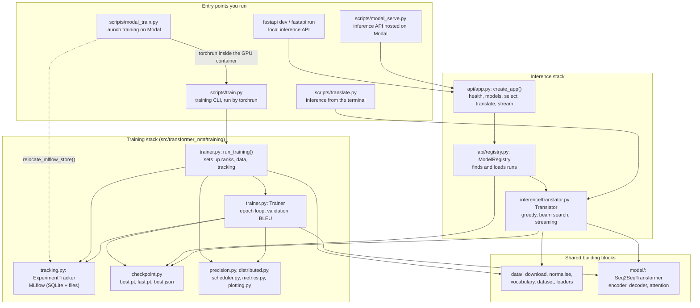
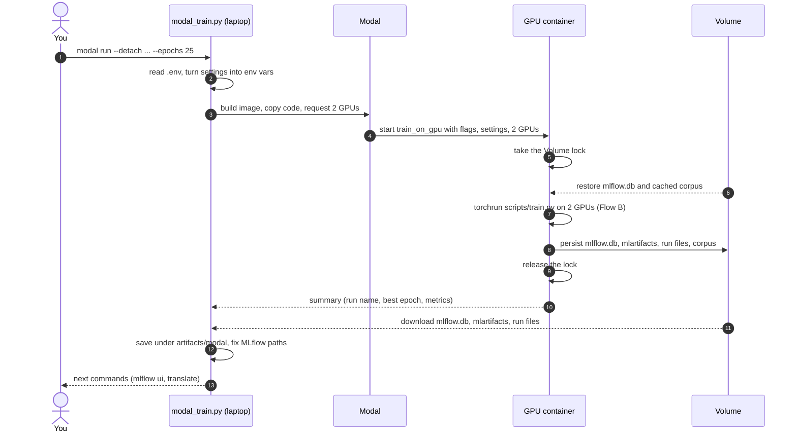
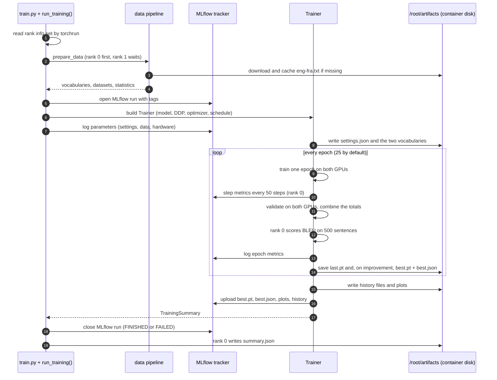
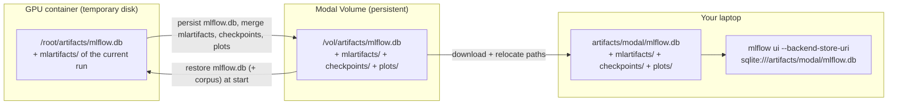
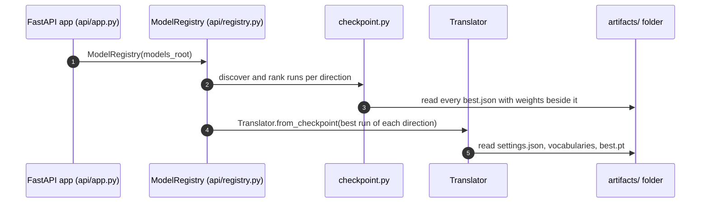
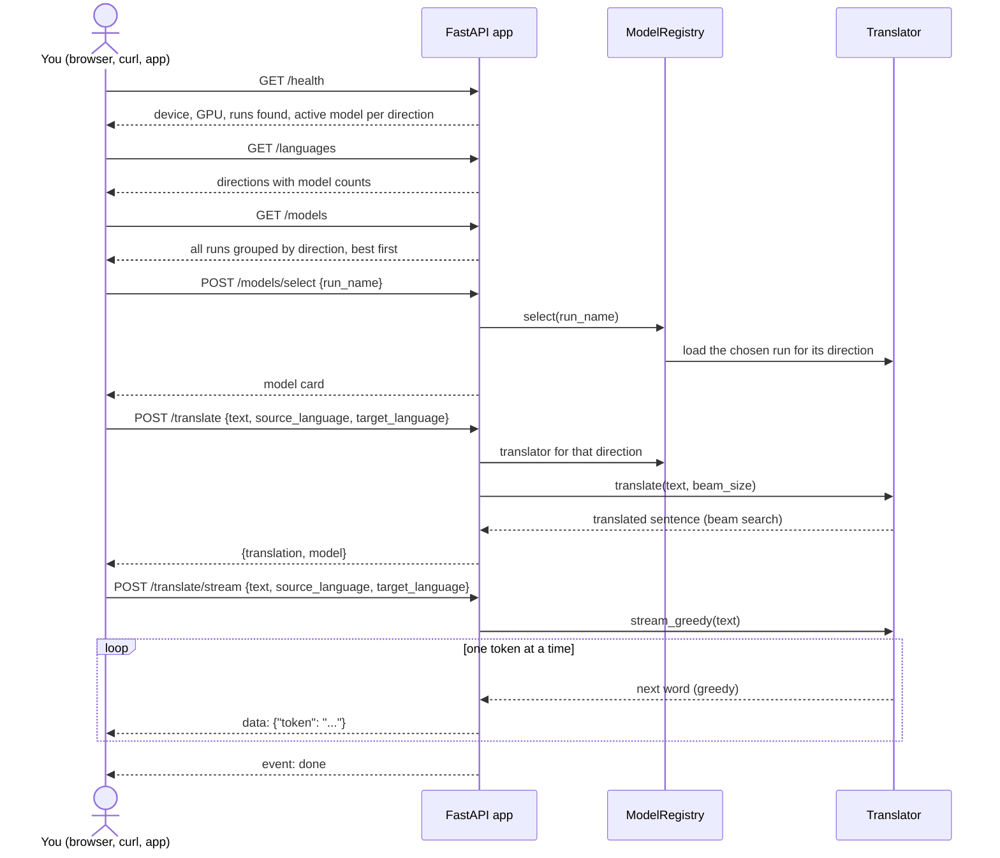
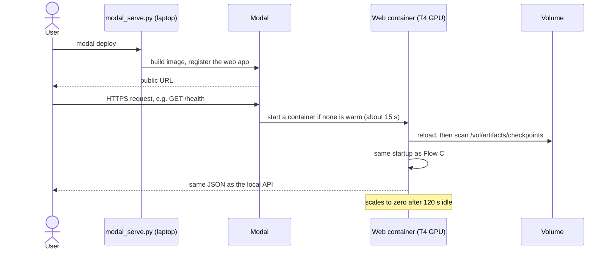
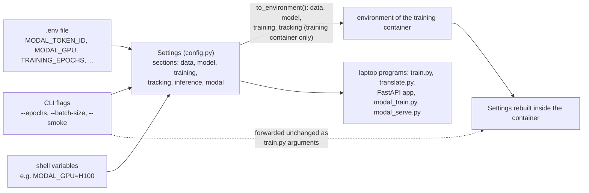
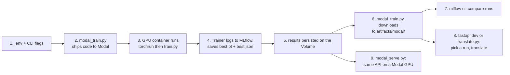

# How the project fits together

This guide explains, step by step, how the pieces of this repository talk to each other: where a
training run starts, which file sends work to Modal (the cloud GPU provider), what happens inside the
GPU machine, where MLflow (the experiment notebook) records things, how results come back to your
laptop, and how the translation API finds and loads the best model. It is written for readers who do
not program. Every technical word used below is defined in the glossary at the end, and the diagrams
are in Mermaid, which GitHub renders as pictures.

If you only remember one thing: **everything starts from a settings file and ends in the
`artifacts/` folder**. Training fills that folder with checkpoints, metrics and plots; inference
(translating) reads it back.

## 1. The cast of characters

| Component | Plain-English role | Where it lives |
|---|---|---|
| Settings | The single rulebook. Every knob (model size, epochs, GPU type, folder names) is read from `.env` and environment variables. | `src/transformer_nmt/config.py` |
| Data pipeline | Downloads the English-French sentence pairs, cleans them, splits them into training and validation sets and turns words into numbers. | `src/transformer_nmt/data/` |
| Model | The Transformer network itself (encoder, decoder, attention). | `src/transformer_nmt/model/` |
| Trainer | Runs the learning loop on one or many GPUs, measures progress, saves checkpoints and reports to MLflow. | `src/transformer_nmt/training/` |
| MLflow | The lab notebook: a one-file database plus a folder of files recording every experiment (parameters, metrics per epoch, plots, best checkpoint). | `artifacts/mlflow.db` for laptop runs, `artifacts/modal/mlflow.db` for runs pulled from Modal |
| Modal launcher | The courier: packages the code, rents GPUs on Modal, runs the training there and brings the results back. | `scripts/modal_train.py` |
| Translator | Loads a saved checkpoint and translates sentences, optionally one word at a time. | `src/transformer_nmt/inference/translator.py` |
| FastAPI service | A small web server with a health check, the list of language directions and trained models, a manual model selector and two translate endpoints (one normal, one streaming). One model serves each direction (English→French, English→Spanish, Spanish→English). | `src/transformer_nmt/api/` |
| Modal API host | Runs that same web server on a Modal GPU, reading checkpoints from Modal's persistent disk. | `scripts/modal_serve.py` |

Three storage locations matter, and the diagrams always say which one is acting:

- **The GPU container's own disk** (`/root/artifacts`): fast but temporary. It disappears when the
  container stops, which is why files are copied in from the Volume before training and out again
  after it.
- **The Modal Volume** (`transformer-nmt-artifacts`, mounted at `/vol`; the project keeps everything
  under `/vol/artifacts`): Modal's persistent disk in the cloud. Nothing written there is lost between
  runs.
- **Your laptop's `artifacts/` folder.** Runs executed on the laptop write to `artifacts/` directly;
  results pulled from Modal land in `artifacts/modal/`. The inference tools scan both.

## 2. Map of the Python files

The arrows mean "uses" or "calls". The five entry points you actually run are at the top (training on
the left, inference on the right); the shared building blocks are at the bottom. Every entry point
also reads the Settings rulebook, which is left out of the picture to keep it readable.



Key facts to take from the map:

- `scripts/modal_train.py` never trains anything itself. It ships the code to Modal and, inside the
  GPU container, runs `scripts/train.py` through `torchrun` (PyTorch's multi-GPU launcher). It also
  fixes the MLflow file paths after downloading results (`relocate_mlflow_store`).
- `scripts/train.py` is the only training entry point. It works identically on a laptop and in Modal;
  the environment variables it receives decide where files go.
- MLflow is written by exactly one module, `training/tracking.py`. Nothing in inference reads MLflow.
- Inference (API, Modal host and terminal tool) finds models through `training/checkpoint.py`, which
  looks for the small `best.json` cards that training leaves next to each `best.pt`.

## 3. Flow A: launching a training run on Modal

Command: `uv run --env-file .env modal run --detach scripts/modal_train.py --epochs 25`



What happens at each numbered step:

1. You run one command on the laptop. The `--detach` flag keeps the cloud job alive even if you
   close the laptop.
2. The launcher reads `.env` through the Settings rulebook. It sets your Modal tokens in the
   laptop's own environment so the Modal client can log in (the tokens are never sent to the GPU
   machine). It then converts the `data`, `model`, `training` and `tracking` settings into
   `PREFIX_FIELD` environment variables (`Settings.to_environment()`); the `inference` and `modal`
   settings stay on the laptop, and `DATA_LOCAL_FILE` is dropped because the container downloads the
   corpus itself.
3. Modal builds a reusable Linux image from `pyproject.toml` and `uv.lock` (the same libraries you
   have locally; built once, cached afterwards). The project's own code (`transformer_nmt` and
   `scripts/train.py`) is copied from your laptop into the container on every launch, so whatever is
   on your disk is what trains. The GPU type and count come from `MODAL_GPU` and `MODAL_GPU_COUNT`
   (default: two A100-40GB).
4. Modal starts the remote function `train_on_gpu` on the GPU machine with the arguments, the
   exported settings and the number of GPUs.
5. Before touching shared files the container takes a lock stored in a small Modal key-value store.
   If another run holds the lock, this one waits. This protects the MLflow database from two runs
   writing at the same time.
6. It restores two things from the Volume into its own disk: the MLflow database (so the new run is
   added to the existing history) and the cached corpus file (so nothing is downloaded again). Both
   were put on the Volume by earlier runs in step 8.
7. It launches `torchrun` with one process per GPU. Each process runs `scripts/train.py` with the
   extra flags `--launcher modal` (recorded as an MLflow tag) and
   `--summary-json /root/artifacts/summary.json`. Flow B describes what they do.
8. When training ends, and also when it fails, the container copies the updated MLflow database, the
   MLflow artifact folder, the run's checkpoints and plots, the downloaded corpus and `summary.json`
   to the Volume, then asks Modal to make those files permanent (a Volume "commit", unrelated to git).
9. The lock is released.
10. The function returns a small summary (run name, MLflow run id, best epoch, best loss, final
    metrics) to the laptop.
11. The launcher downloads the MLflow database, the MLflow artifact folder and the run's checkpoint
    and plot folders from the Volume. Intermediate checkpoints (`epoch-XXX.pt`, `last.pt`) are skipped
    unless you pass `--all-checkpoints`.
12. Everything is saved under `artifacts/modal/`. MLflow stores absolute file paths from the
    container (`/root/artifacts/...`), so the launcher rewrites them to the laptop's paths
    (`relocate_mlflow_store`). Without this the MLflow UI would show broken links to plots and
    checkpoints.
13. It prints the command to open MLflow and the command to translate with the new model.

Other flags of the same command: `--smoke` runs the identical path on a 3,000-pair subset for 2
epochs (a rehearsal); `--batch-size` and `--precision` override those two settings; `--run-name NAME`
names the run yourself; `--no-download` trains without
pulling results back; `--no-train` skips steps 3 to 10 and only downloads the most recently modified
run directory on the Volume (pass `--run-name` to pick a specific one; a failed run is persisted too,
so "most recent" is not always "finished"). `--no-train` is how you fetch the results of a detached
run later.

## 4. Flow B: inside the GPU container, one training run

This is `scripts/train.py` as started by `torchrun`. Two copies run at the same time (rank 0 and
rank 1), one per GPU; they split every batch between them and average their learning, so the two
GPUs behave like one bigger one. Only rank 0 talks to MLflow and writes files; both ranks compute.
Inside the container the artifacts folder is `/root/artifacts`, the temporary disk described in
Section 1.

Two words that appear everywhere below: a **step** is one batch of sentences (128 per GPU, 256 in
total) going through the model once; an **epoch** is one full pass over all training sentences,
about 477 steps. Step metrics are recorded every 50 steps, epoch metrics once per pass.



What happens at each numbered step:

1. `scripts/train.py` builds the Settings from the environment variables exported in Flow A plus
   any flags (`--epochs`, `--batch-size`, `--precision`, `--max-pairs`, `--run-name`, `--experiment`,
   `--smoke`) and calls `run_training` (passing `--device` straight through for laptop runs), which reads the variables `torchrun` sets (`RANK`,
   `WORLD_SIZE`) to learn that it is one of two processes. On a laptop it simply runs alone.
2. Rank 0 prepares the data first so only one process downloads; rank 1 waits, then reads the same
   cached file.
3. The data pipeline downloads the Tatoeba corpus (2.9 MB) from the PyTorch mirror the first time
   and extracts `eng-fra.txt` into the artifacts folder.
4. It normalises the text (lower-case, keeps accents and the `œ` ligature, separates punctuation),
   drops exact duplicates, splits 90% training / 10% validation **grouped by English sentence** so no
   source sentence appears on both sides, builds the two vocabularies from the 90% training portion
   only, and encodes every pair as numbers. It hands back the vocabularies, the two datasets and some
   statistics (pair counts, vocabulary sizes, sentence lengths).
5. The tracker opens an MLflow run. The run name encodes the date and time (UTC), the GPU, the
   precision, the global batch size (per-GPU batch times number of GPUs) and the run type, for
   example `20261030-2020-a100-sxm4-40gb-bf16-bs256-full`; `--run-name` overrides it. Tags record the
   GPU name, precision, number of GPUs, run type, launcher and git commit.
6. The Trainer builds the Transformer, wraps it for multi-GPU training (DDP), and creates the
   optimizer, the learning-rate schedule (warm up, then decay), the data loaders and the number
   format policy (the faster bf16 format on A100-class GPUs).
7. Everything that describes the experiment is logged once as MLflow parameters: all settings,
   dataset statistics, hardware (GPU name, memory, CUDA, PyTorch version), parameter count, steps per
   epoch.
8. When the loop starts, rank 0 writes the three files inference will need later: `settings.json`
   (architecture), `source_vocab.json` and `target_vocab.json` (word lists).
9. Each epoch, both GPUs process their half of the training data; extreme updates are capped
   (gradient clipping) and the learning rate follows the schedule.
10. Every 50 steps, rank 0 logs step-level metrics to MLflow under `step/*` (loss, learning rate,
    gradient size, tokens per second).
11. Validation runs on both GPUs; loss sums and token counts are added across ranks so the numbers
    are exact rather than averages of averages.
12. Rank 0 translates a fixed subset of 500 validation sentences and scores them with BLEU.
13. Epoch metrics are logged under `train/*`, `val/*` and `system/*` with the epoch number as the
    x-axis: loss, perplexity, token accuracy, BLEU, epoch time, peak GPU memory.
14. `last.pt` is always refreshed. When validation loss improves, `best.pt` is written together with
    `best.json`, a tiny card saying which metric, value, epoch, file name and run type it corresponds
    to. Every 5 epochs an extra `epoch-XXX.pt` is kept.
15. At the end the per-epoch history is saved as JSON and CSV and two figures are rendered (training
    curves, step dynamics).
16. The best checkpoint and its card, the settings and vocabulary files, the history, the plots and a
    dozen sample translations are uploaded into the MLflow run, so the experiment is self-contained
    in MLflow too.
17. The Trainer returns a `TrainingSummary` (run name, MLflow run id, epochs completed, best metric
    and epoch, best checkpoint path, training time, final metrics).
18. The MLflow run is closed as FINISHED, or FAILED if an error interrupted training.
19. Rank 0 writes `summary.json`. The container reads it as soon as `torchrun` exits: Flow A step 8
    uses its run name to pick the folders to persist, and step 10 returns it to the laptop.

## 5. Where MLflow lives and how to look at it

MLflow has two parts: a **SQLite database** (`mlflow.db`, a single file) with experiments, runs,
parameters, metrics and tags, and an **artifact folder** (`mlartifacts/<experiment>/<run_id>/artifacts/`)
with the files uploaded in Flow B step 16. The experiment is `transformer-nmt-eng-fra` (`-smoke`
suffix for rehearsal runs).



- Only the database (and the corpus) is copied **into** the container before training; the artifact
  folder is written fresh for the current run and **merged** into the Volume's copy afterwards. Every
  Modal run is therefore appended to one shared history on the Volume.
- On your laptop you browse that history with
  `uv run mlflow ui --backend-store-uri sqlite:///artifacts/modal/mlflow.db --port 5001`.
- A training run executed directly on the laptop (`uv run python scripts/train.py`) uses
  `artifacts/mlflow.db` instead, viewable the same way without the `modal/` part. The unit tests write
  to a throw-away temporary folder and leave no trace in `artifacts/`.
- MLflow is for people: comparing runs, reading curves, downloading the exact checkpoint of an
  experiment. The programs that translate do not read it; they use the `best.json` cards described
  next.

## 6. How the best model is found

Every run directory looks like this:

```
artifacts/modal/checkpoints/<run_name>/
  best.pt            weights at the best validation epoch
  last.pt            weights at the final epoch (kept on the Volume, skipped on download)
  best.json          {"run_name", "metric": "val/loss", "value", "epoch", "checkpoint_file": "best.pt", "run_type"}
  settings.json      architecture and training settings of this run
  source_vocab.json  English word list
  target_vocab.json  French word list
  history.json/csv   per-epoch metrics
```

`training/checkpoint.py` provides the shared rule used by the terminal tool, the FastAPI service
and the Modal host:

1. `discover_checkpoints` walks a folder recursively and collects every `best.json` whose checkpoint
   file (the one named in its `checkpoint_file` field) sits next to it.
2. `rank_checkpoints` sets rehearsal (smoke) runs aside because their validation set is different, so
   their numbers are not comparable; they are only considered when no full run exists. It then
   requires that the remaining runs were selected with the same yardstick (loss or BLEU) and sorts
   them best-first: lowest loss, or highest BLEU if a run was selected on BLEU. If runs with two
   different yardsticks coexist and none is chosen, it stops with an error.
3. `find_best_checkpoint` returns the first entry. This is the path `scripts/translate.py` takes: the
   terminal tool only falls back to smoke runs when no full run exists, and in the mixed-yardstick case
   it stops with an error (`Runs were selected with different metrics ...`); the workaround is to pass
   `--checkpoint` or set `INFERENCE_CHECKPOINT_PATH`.

The FastAPI service and the Modal host apply the same ranking through `ModelRegistry.models()`
(`api/registry.py`) with three additions: each run's language direction is read from its
`settings.json` and the ranking is done per direction (`en→fr`, `en→es`, `es→en`), the smoke runs set
aside in step 2 are appended at the end of their direction so `GET /models` still lists every run, and
if runs were selected with different yardsticks they are grouped by yardstick instead of raising an
error.

One caveat to know about: MLflow keeps a second `best.json` + `best.pt` pair for each run under
`mlartifacts/<experiment>/<run_id>/artifacts/checkpoints/` (uploaded in Flow B step 16 and downloaded
in Flow A step 11). When the scan root is `artifacts/`, that copy also passes the "weights next to the
card" test, so a run that was logged to MLflow can appear twice in `GET /models`, the second time with
a `checkpoint_path` inside `mlartifacts/`. The copy under `checkpoints/<run_name>/` sorts first and is
the one loaded; the MLflow copy cannot be loaded on its own because `settings.json` and the
vocabularies were uploaded to the neighbouring `run/` folder. The Modal-hosted API is not affected
because it scans `/vol/artifacts/checkpoints` only. Pointing `INFERENCE_MODELS_ROOT` at
`artifacts/modal/checkpoints` removes the duplicates locally as well.

## 7. Flow C: translating with the FastAPI service

Command: `uv run fastapi dev` (development, auto-reload) or `uv run fastapi run` (production). The
FastAPI CLI finds the app through `[tool.fastapi] entrypoint = "transformer_nmt.api.app:app"` in
`pyproject.toml`, so no path has to be typed.

### Startup



1. When the server starts (FastAPI's "lifespan" hook), it creates a `ModelRegistry` pointing at the
   models folder: `INFERENCE_MODELS_ROOT` if set, otherwise `artifacts/`, which contains both laptop
   runs and the runs pulled from Modal.
2. The registry asks `checkpoint.py` to discover the runs, reads each run's language direction from
   its `settings.json` and ranks the runs of every direction (Section 6).
3. Only `best.json` cards that have their weights next to them count (see the caveat in Section 6).
4. The best-ranked run of every direction is loaded immediately. Set
   `INFERENCE_AUTOLOAD_BEST_MODEL=false` to start with nothing loaded and choose by hand.
5. Loading a run means reading its `settings.json` to rebuild the exact architecture, its two
   vocabularies, and the weights in `best.pt`. The model is placed on the best available device: an
   NVIDIA (CUDA) GPU, the Apple GPU, or the CPU.

### Handling requests



Languages are two-letter codes (`en`, `es`, `fr`). Every request body carries only what is needed:
the sentence, the direction and, optionally, the beam size.

- `GET /health` tells you the device and GPU, how many runs were found and which run is active for
  each direction. The status is `no-model-selected` when nothing is loaded yet.
- `GET /languages` lists the directions that have at least one trained model, how many, and the
  active run of each. Use it to know what you can ask for.
- `GET /models` lists every run (name, direction, yardstick, value, best epoch, run type, active flag),
  grouped by direction and best first, so you can pick one by name.
- `POST /models/select` with `{"run_name": "..."}` loads the chosen run and makes it the active model
  for its own direction only. An unknown name returns a 404 error.
- `POST /translate` with `{"text", "source_language", "target_language", "beam_size"}` picks the active
  model of that direction (loading the best one on demand), cleans and tokenises your sentence exactly
  as training did, runs the encoder once, then beam search in the decoder (`beam_size` 1 switches to
  greedy decoding), and returns `{"translation", "model"}`: the sentence and the run that produced it.
  A direction without any trained model returns 404; with autoload disabled, a direction whose model
  was not selected yet returns 409.
- `POST /translate/stream` with `{"text", "source_language", "target_language"}` uses greedy decoding
  and sends each translated word as a server-sent event the moment it is produced, ending with
  `event: done`.

The interactive documentation at `/docs` lets you try every endpoint from a browser.

## 8. Flow D: the same API hosted on Modal

Command: `uv run --env-file .env modal deploy scripts/modal_serve.py`



- `modal deploy` builds the image (same recipe as training) and registers `TranslationService.web`,
  the very same FastAPI app as Flow C, served from a container with a `MODAL_INFERENCE_GPU` (default
  T4, which is plenty for a 10M-parameter model).
- The models folder is different: the registry scans the checkpoints that training persisted on
  the Volume (`/vol/artifacts/checkpoints`), so a freshly trained run becomes available to the hosted
  API the next time a container starts. Because `mlartifacts/` is a sibling folder, the duplicates
  mentioned in Section 6 do not occur here.
- Unlike training, your `.env` is **not** sent to this container. The hosted API runs with the
  built-in defaults (load the best run automatically, 40-word limit, beam size chosen per request);
  only the Modal settings (`MODAL_INFERENCE_GPU`, volume name, mount path, scale-down time) are read on
  your laptop at deploy time.
- The container shuts down after 120 seconds without requests and starts again on the next one,
  which is where the cold-start delay of about 15 seconds comes from.

## 9. Flow E: translating from the terminal

`uv run python scripts/translate.py "I love this movie."` uses the same pieces without a web server:
the Translator asks `checkpoint.py` for the best run under `artifacts/` (or uses the `--checkpoint`
you pass), loads it and prints the translation. `--beam-size 1` gives greedy decoding; with no
sentence it opens an interactive prompt.

## 10. Where the settings come from



Every section has a prefix (`DATA_`, `MODEL_`, `TRAINING_`, `TRACKING_`, `INFERENCE_`, `MODAL_`), so
`TRAINING_EPOCHS=25` in `.env` and `--epochs 25` on the command line mean the same thing. When a
training run is sent to Modal, the `data`, `model`, `training` and `tracking` settings resolved from
`.env` and the shell are serialised back into variables, the command-line flags are forwarded as
arguments of `scripts/train.py`, and both are combined again in the container, which is why a run always uses exactly
the configuration you resolved locally. The `modal` and `inference` sections, your tokens and any
local-only file path stay on the laptop; inside the container the artifacts folder is forced to
`/root/artifacts` and any custom MLflow address is cleared so the run uses the restored database.
The hosted inference API (Flow D) receives no settings at all and uses the defaults.

## 11. End-to-end in one picture



## 12. Glossary

- **uv**: the tool that installs the project's libraries and runs its commands; every command in this
  repository starts with `uv run`.
- **Settings / `.env`**: the rulebook of named values (`TRAINING_EPOCHS=25`) that every program reads.
- **Step and epoch**: a step is one batch of sentences (256 across both GPUs) passing through the
  model once; an epoch is one full pass over all training sentences, about 477 steps here. The default
  run makes 25 epochs.
- **Checkpoint**: a saved copy of the model's weights (`.pt` file). `best.pt` is the copy with the
  lowest validation loss; `best.json` is the small card describing it.
- **Validation set**: the 10% of sentence pairs the model never trains on, used to measure real
  progress.
- **Loss and perplexity**: loss measures how wrong the model's word predictions are (lower is
  better); perplexity is the same quantity expressed as "how many words the model hesitates between"
  (a perplexity of 3 means it is torn between about three choices).
- **Token accuracy**: the share of words the model guesses exactly right.
- **BLEU**: a 0 to 100 translation-quality score comparing the model's sentences with the reference
  translations; computed here with the sacreBLEU library on 500 validation sentences.
- **Greedy decoding**: producing a translation by always picking the single most likely next word.
  Fast, and the only mode that can stream word by word.
- **Beam search**: keeping the few best partial sentences (4 by default) at every word and returning
  the best complete one. Slower but usually better; the default for `/translate`.
- **Gradient clipping**: capping unusually large learning updates so one odd batch cannot derail
  training.
- **bf16**: a 16-bit number format supported by A100/H100-class GPUs that roughly doubles speed with
  no loss of training stability.
- **CUDA**: NVIDIA's GPU software; "CUDA GPU" simply means an NVIDIA graphics card.
- **DDP (DistributedDataParallel)**: PyTorch's way of training one model on several GPUs at once.
  `torchrun` starts one process per GPU; `WORLD_SIZE` is the number of processes and `RANK` the id of
  each one. **NCCL** is the channel the GPUs use to exchange numbers while training.
- **MLflow**: an open-source tool that records experiments so they can be compared later. It uses
  **SQLite**, a database that lives in a single file (`mlflow.db`).
- **Modal**: a cloud service that rents GPUs by the second. A **Volume** is its persistent disk; a
  Volume **commit** makes newly written files permanent (nothing to do with git).
- **FastAPI**: the Python web framework that serves the inference endpoints. **ASGI** is the
  standard way a Python web app plugs into a web server, so "ASGI app" just means "the web service";
  the **lifespan** hook is where the app loads the model at startup. **SSE** (server-sent events) is
  the streaming format used by `/translate/stream`.
- **Language codes**: the API names languages with two letters (`en` English, `es` Spanish, `fr`
  French), derived from the language names recorded in each run's settings.
- **HTTP 404 / 409**: error codes returned by the API for "unknown run name or direction" and "no
  model selected for this direction".
